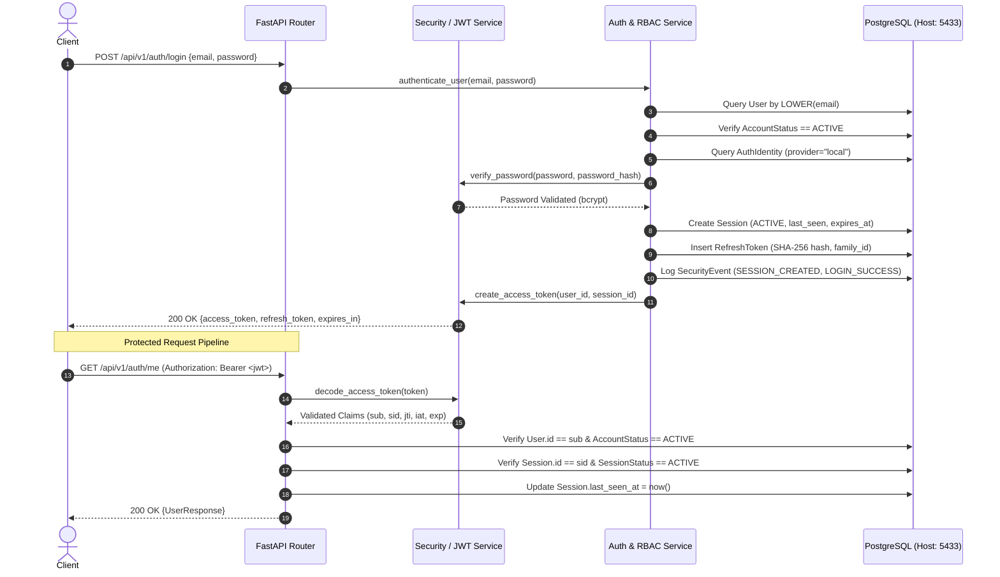

# Identity and Authentication Architecture — Stage 3

## 1. Overview and Core Philosophy

UniteCare separates identity, authentication, session management, and authorization into distinct, decoupled architectural layers. The platform serves multi-NGO disaster response, humanitarian logistics, and social-impact coordination; therefore, security boundaries must be strictly established from day one without hardcoding domain-specific roles into core authentication primitives.

### Core Architectural Invariants
* **Authentication != Authorization**: Proving who an actor is (authentication) does not determine what actions they may execute (authorization).
* **User != Role**: A User identity represents a human or machine actor. A Role is an administrative bundle of granular permissions.
* **Account Status != Role**: Administrative suspension or disabling occurs at the account lifecycle level, not by mutating role assignments.
* **Password Credential != User Identity**: Credentials reside in `auth_identities`, allowing future identity providers (e.g. SAML, OAuth) without rewriting user accounts.
* **Access Token != Session**: The JWT access token is a short-lived bearer credential verifying authentication. The Session record in PostgreSQL is the server-side authority governing login context, device lifecycle, and revocation.
* **Backend is the Sole Authority**: Clients never decide roles, session lifetimes, or permissions.
* **PostgreSQL is the Current Source of Truth**: Redis is acknowledged as a future scalability optimization, but is strictly omitted in Stage 3 to avoid premature architectural complexity.

---

## 2. Component Pipeline

---

## 3. Data Entity Separation

| Entity | Primary Key | Purpose | Key Guarantees |
|---|---|---|---|
| `users` | UUID | Core identity & contact email | Functional unique index `LOWER(email)`, `AccountStatus` (ACTIVE, SUSPENDED, DISABLED) |
| `auth_identities` | UUID | Authentication mechanism | `provider="local"`, bcrypt password hash, unique on `(user_id, provider)` |
| `sessions` | UUID | Client device login context | `status` (ACTIVE, REVOKED, EXPIRED), IP, user agent, expiration |
| `refresh_tokens` | UUID | Rotating token chains | SHA-256 hash only (`VARCHAR(64)`), `family_id` tracking, `used_at`, `revoked_at` |
| `security_events` | UUID | Append-only audit log | Non-repudiation, sensitive parameter redaction, structured JSONB metadata |
| `roles` | UUID | Permission bundle | Name unique, baseline `public_user` |
| `permissions` | UUID | Granular authorization verb | Name unique (e.g. `users:read`, `users:manage`) |
| `user_roles` | `(user_id, role_id)` | Role assignment | Explicit `assigned_by` audit column, cascade on delete |
| `role_permissions` | `(role_id, permission_id)` | Permission mapping | Pure M2M association |

---

## 4. What Is Intentionally NOT Implemented in Stage 3

To preserve absolute architectural boundaries, the following domains are strictly excluded:
* **OAuth Providers**: No Google, Apple, or GitHub OAuth handlers.
* **Email / OTP**: No email dispatching or phone OTP verification.
* **Redis**: No caching layer or distributed lock managers.
* **Business Domains**: No NGO registration, volunteer workflows, donor pledges, or impact tracking.
* **Mock / Seed Data**: Zero mock users exist in production schemas.
